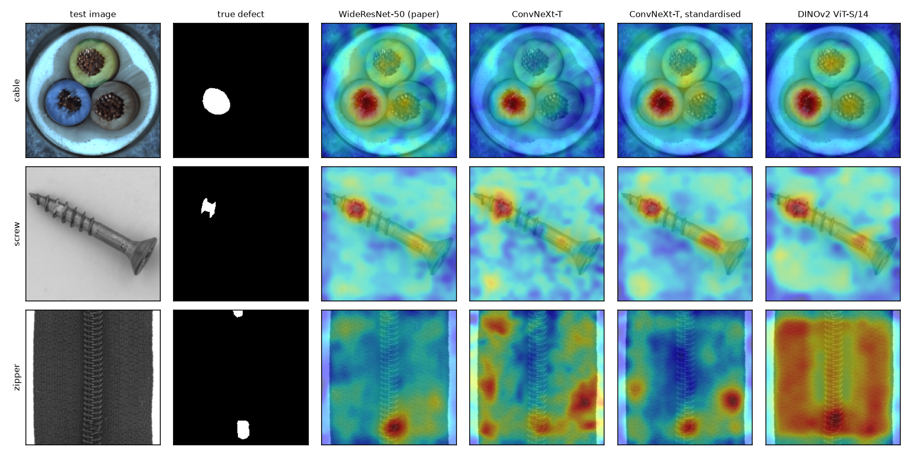
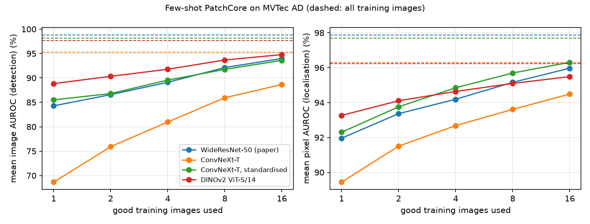

# PatchCore on MVTec AD: reproduction, backbone study, and why ConvNeXt needs standardised features

A from-scratch PyTorch implementation of **PatchCore** (Roth et al., *Towards Total Recall in Industrial Anomaly Detection*, CVPR 2022) on the 15 categories of **MVTec AD**. It finds and localises defects in industrial images while training only on *good* parts: no defect labels and no gradient training. I reproduce the paper, then compare three frozen backbones: the paper's WideResNet-50, ConvNeXt-T and self-supervised DINOv2 ViT-S/14. I also test few-shot settings and coreset size, and find (and fix) why ConvNeXt does surprisingly badly.

Everything ran on a 4 GB laptop GPU (RTX 2050): 4 feature settings × 15 categories × (2 coreset sizes + 5 few-shot sizes × 3 draws), about 80 minutes in total.

```
good training images ─► frozen backbone ─► mid-level patch features ─► greedy coreset ─► memory bank
test image           ─► frozen backbone ─► patch features ─► distance to nearest bank patch ─► anomaly map
                                                                                         └─► image score = max
```

## Results at a glance (mean over the 15 categories, 1,725 test images)

| feature extractor | image AUROC | pixel AUROC | 1-shot image AUROC | memory bank (10%) | scoring ms / image |
|---|---|---|---|---|---|
| WideResNet-50, layers 2+3 (the paper's choice) | **98.8** | **97.9** | 84.3 | 18,967 × 1536 | 39.6 |
| ConvNeXt-T, stages 1+2 | 95.3 | 96.3 | 68.7 | 18,967 × 576 | 14.2 |
| **ConvNeXt-T, standardised channels (my fix)** | 98.2 | 97.7 | 85.5 | 18,967 × 576 | 14.1 |
| DINOv2 ViT-S/14, blocks 8+11 | 97.6 | 96.2 | **88.8** | 6,193 × 768 | **2.2** |

The paper reports 99.0 image and 98.1 pixel AUROC for its 10% coreset. All numbers above use a 10% coreset and 224×224 inputs. "Scoring" is the nearest-neighbour search plus upsampling, per test image; the backbone forward pass is not included. Per-category tables are in [results/summary.md](results/summary.md).



*Zipper row: raw ConvNeXt features light up false hotspots, while the same features after standardisation find the real defect (bottom). More examples: [results/figures/heatmaps.png](results/figures/heatmaps.png).*

## What I found

### RQ1. The reproduction works
WideResNet-50 with a 10% coreset reaches **98.8% image AUROC and 97.9% pixel AUROC**, within 0.2 points of the paper (99.0 / 98.1). The weakest categories are pill (94.7), capsule (97.5) and grid (97.7). One small difference: I concatenate the two feature maps (1536 dimensions) instead of pooling them down to 1024.

### RQ2. A better ImageNet classifier is *not* a better anomaly detector... at first
ConvNeXt-T beats WideResNet-50 on ImageNet (82.1% vs 78.5% top-1) but was clearly worse here: 95.3 vs 98.8 image AUROC. It collapsed on grid (83.0), zipper (88.8), capsule (86.7) and toothbrush (90.0), and at 1-shot it was the worst backbone by far (68.7).

### RQ5 (extension). Why, and the fix: one channel holds 91% of the feature variance
I measured how the variance of the patch features is spread over channels ([tools/feature_stats.py](tools/feature_stats.py), all good training patches):

| backbone | variance held by the single largest channel (mean over 15 categories) | that channel's largest value | a typical channel's largest value |
|---|---|---|---|
| WideResNet-50 | 1.4% (0.6 to 5.2%) | ~1 | 0.3 |
| **ConvNeXt-T** | **91.3% (69.2 to 97.5%)**, always channel 223 | **1143** | 4.5 |
| DINOv2 ViT-S/14 | 2.5% (1.3 to 4.8%) | ~8 | 0.7 |

ConvNeXt has a **"massive activation" channel**: stage-2 channel 31 (223 in the concatenated features) takes values above 1000 while the others stay below about 5. PatchCore's Euclidean nearest-neighbour distance is therefore **almost a one-dimensional comparison along that channel**, and a defect that shows up in the other 575 channels barely changes the distance. Two consequences:
1. It also broke the fast distance formula ‖q‖² − 2q·b + ‖b‖². With ‖q‖² that large, the formula cancels catastrophically: 5% error even in fp32. [patchcore/patchcore.py](patchcore/patchcore.py) therefore re-computes the shortlisted distances exactly.
2. **The fix:** standardise every channel (z-score) with the mean and standard deviation of the *good training* patches, then run PatchCore unchanged (`run_study.py --standardize`). In few-shot runs the statistics come from the k images only, so no test data is used.

Result: **95.3 → 98.2 image AUROC and 96.3 → 97.7 pixel AUROC**, with gains up to +12.7 on grid, +8.7 on zipper and +8.5 on capsule. 1-shot goes from 68.7 to 85.5, and the spread between random draws falls from 6.8 to 2.0 points. Standardised ConvNeXt-T is within 0.6 points of WideResNet-50, beats it on 7 of 15 categories, and scores **2.8× faster** because its features are 2.7× smaller. Standardisation is *not* a free trick, though. On WideResNet-50, whose variance is already spread out, it **hurt** (grid 97.4 → 94.5, capsule 97.7 → 93.2 in a 1% coreset check): it amplifies low-variance, noisy channels. It helps exactly when one channel dominates.

### RQ3. Few-shot: self-supervised features need the fewest examples


With only **one** good image per category, DINOv2 reaches 88.8% image AUROC (WideResNet-50: 84.3%). It stays best up to 16 images (94.8%), and its draw-to-draw spread is the smallest (1.6 points). With all images WideResNet-50 wins again. DINOv2's 16×16 patch grid (14-pixel patches) is coarser than the CNNs' 28×28, which costs it localisation (96.2 pixel AUROC) and small-defect categories (screw 90.0). AnomalyDINO (2025) reports much higher few-shot numbers with DINOv2, using larger images and extra tricks such as masking and augmentation.

### RQ4. A 1% coreset is almost free
| backbone | coreset | image AUROC | pixel AUROC | bank size | scoring ms / image |
|---|---|---|---|---|---|
| WideResNet-50 | 1% | 98.7 | 97.7 | 1,896 | 6.0 |
| WideResNet-50 | 10% | 98.8 | 97.9 | 18,967 | 39.6 |
| ConvNeXt-T, standardised | 1% | 98.2 | 97.6 | 1,896 | 2.9 |
| DINOv2 ViT-S/14 | 1% | 97.1 | 95.6 | 619 | 1.2 |

A memory bank 10× smaller loses at most 0.6 points and scores 2 to 7× faster. Greedy k-center selection keeps the *edges* of the normal distribution, so the rare-but-normal patches that random subsampling would lose stay in the bank.

## How to run

```bash
pip install -r requirements.txt
# MVTec AD (CC BY-NC-SA 4.0) from the Hugging Face mirror Voxel51/mvtec-ad (~5 GB), see patchcore/data.py
python run_study.py --root data/mvtec-ad                      # 3 backbones x 15 categories (~60 min, RTX 2050)
python run_study.py --root data/mvtec-ad --backbones convnext_t --standardize   # RQ5 (~15 min)
python tools/feature_stats.py --root data/mvtec-ad            # channel-variance table (~6 min)
python tools/report.py                                                # tables + figures
```

Quick check on two categories: `python run_study.py --backbones wrn50 --categories bottle screw`. Results are saved after every category, so an interrupted run resumes where it stopped.

## Code map

| file | what it does |
|---|---|
| [patchcore/features.py](patchcore/features.py) | frozen backbones (timm), mid-level feature maps, 3×3 neighbourhood averaging, concatenation |
| [patchcore/patchcore.py](patchcore/patchcore.py) | greedy k-center coreset (random 128-d projection), chunked two-stage exact nearest-neighbour search, anomaly maps |
| [patchcore/data.py](patchcore/data.py) | MVTec AD index, resize 256 → centre-crop 224, masks |
| [run_study.py](run_study.py) | the whole study: coreset 1% / 10%, few-shot 1 to 16 images × 3 draws, `--standardize` |
| [tools/feature_stats.py](tools/feature_stats.py) | per-channel variance of each backbone's features (the RQ5 evidence) |
| [tools/report.py](tools/report.py) | summary tables and figures |

## Limitations

- Single runs at 224×224; the paper also reports higher resolutions. The few-shot numbers are averaged over only 3 draws.
- AUROC needs no threshold, but a factory has to pick one. PRO and F1 at a fixed false-positive rate are not reported.
- The timing covers nearest-neighbour scoring only, on one laptop GPU.
- MVTec AD is close to saturated; harder benchmarks (VisA, MVTec AD 2) would separate the backbones more.

## References

1. K. Roth, L. Pemula, J. Zepeda, B. Schölkopf, T. Brox, P. Gehler. *Towards Total Recall in Industrial Anomaly Detection.* CVPR 2022.
2. P. Bergmann, M. Fauser, D. Sattlegger, C. Steger. *MVTec AD: A Comprehensive Real-World Dataset for Unsupervised Anomaly Detection.* CVPR 2019.
3. Z. Liu et al. *A ConvNet for the 2020s* (ConvNeXt). CVPR 2022.
4. M. Oquab et al. *DINOv2: Learning Robust Visual Features without Supervision.* TMLR 2024.
5. S. Damm et al. *AnomalyDINO: Boosting Patch-based Few-shot Anomaly Detection with DINOv2.* WACV 2025.
6. M. Sun, X. Chen, J. Z. Kolter, Z. Liu. *Massive Activations in Large Language Models.* COLM 2024. The same phenomenon, first described in LLMs and ViTs.
